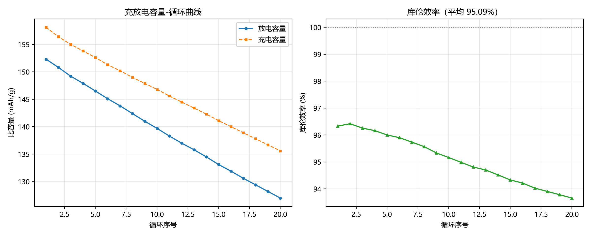

# 大一

安徽建筑大学 · 新能源材料与器件 · 2026 级

这个仓库记录我大一学年的学习轨迹：课程笔记、实验数据处理脚本、以及每周的进展记录。

---

## 为什么建这个仓库

不是为了好看，是因为三件事我需要一个地方放：

1. **实验数据处理脚本**——仪器导出的 CSV 每次都要手动算，写成脚本一次搞定，以后重复用
2. **改坏的代码能找回**——Git 的版本历史，比 `最终版_真的最终版.py` 靠谱
3. **一条可见的成长记录**——一年后回头看，我到底学了什么，一目了然

---

## 目录结构

```
大一/
├── README.md              本文件
├── 课程笔记/               各门课的知识点整理
├── 实验数据处理/            处理仪器数据的 Python 脚本
│   ├── 示例数据.csv         练习用数据
│   └── 示例_CSV处理.py      可直接运行的示例
└── 学习记录/               按日期记录进展
```

---

## 本学期目标

| 目标 | 验收标准 |
|---|---|
| 学业 | 高数、大物、无机化学、英语全部 85+，GPA 进专业前 20% |
| 英语 | 通过四级（目标 450+） |
| 工具 | 掌握 Excel 函数与数据透视表、Origin 基础作图 |
| Python | 能独立写脚本处理实验 CSV 数据 |
| Git | 会用 init / add / commit / push 四条命令 |

---

## 实验数据处理：已跑通的示例

`实验数据处理/示例_CSV处理.py` 读取充放电 CSV，自动完成：

- **编码自动识别**——国产仪器导出常是 GBK，不处理会乱码
- 容量保持率、平均库伦效率、每圈衰减率
- 出图（已配置中文字体，标签不会变方框）
- 导出 Excel 汇总表，可直接贴进实验报告

用示例数据（20 圈）跑出来的结果：

| 指标 | 数值 |
|---|---|
| 首圈放电容量 | 152.3 mAh/g |
| 末圈放电容量 | 127.0 mAh/g |
| 容量保持率 | 83.4 % |
| 平均库伦效率 | 95.09 % |
| 平均每圈衰减 | 1.33 mAh/g |



依赖：`numpy` `pandas` `matplotlib` `openpyxl`

---

## 怎么运行示例脚本

```bash
cd 实验数据处理
python 示例_CSV处理.py
```

脚本只用 Python 标准库，不需要额外安装任何东西。

---

## 学习记录怎么用

每次有进展就在 `学习记录/` 下新建一个 `YYYY-MM-DD.md`，写三行就够：

- 今天做了什么
- 遇到什么问题
- 下一步做什么

然后提交：

```bash
git add .
git commit -m "学习记录：2026-10-22"
git push
```

---

## 备注

- 实验原始数据（几十 MB 的仪器输出）**不放这里**，放网盘，仓库只留处理脚本和小样例
- 具体原因见 `.gitignore` 里的注释